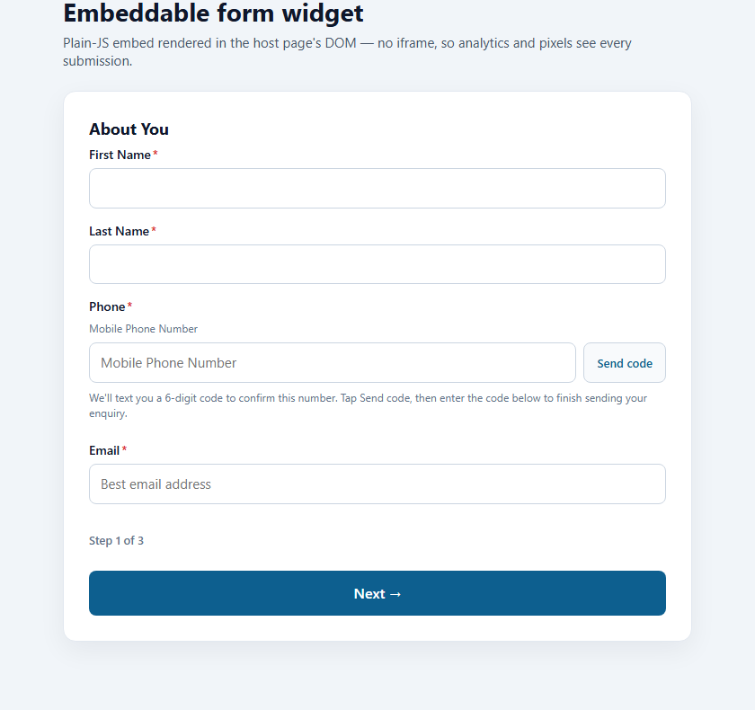

# Peak Forms

Drag-and-drop form builder + embeddable form widget, built for Cloudflare Pages + D1.
A Gravity-Forms-style builder that produces **plain-JS embeds** (no iframes), so forms
live in the host page's DOM and **GTM / Facebook Pixel / analytics actually see submissions**.



**New here?** [SETUP.md](SETUP.md) takes you from clone to a submitted form locally.

- **Builder app** — React + Vite + Tailwind + dnd-kit, served at `/manage/`
- **widget.js** — ~15 KB vanilla JS runtime, Shadow DOM, prefills from URL params
- **API** — Pages Functions (Workers): public form config + submission endpoints, admin CRUD
- **D1** — `sites`, `forms` (config as JSON), `submissions`
- **Anti-spam** — optional Cloudflare Turnstile per form + honeypot + per-IP rate limit
- **Notifications** — per-form webhooks (Make.com etc.), fired after each submission
- **Quiz scoring** — optional per-option points, knockout bands, follow-up flag and
  payment-plan routing; result screen as gauge, traffic lights or nothing
- **Tracking** — optional per-form `dataLayer` event pushed on the host page on success

- **Consent** — a notice under every submit button (global default + per-form override); the exact wording shown and the acceptance time are stored with each submission.
- **Submit webhook** — each successful submission POSTs a fixed JSON contract (incl. consent,
  and score/band/follow-up when scoring is enabled) to a per-form or global endpoint via
  `waitUntil`, fire-and-forget.

## Repo layout

```
app/                 Builder SPA (Vite, base path /manage/)
functions/           Pages Functions (the API)
  api/forms/[slug].js        GET public form config (published only)
  api/forms/[slug]/submit.js POST submission (Turnstile, honeypot, rate limit, webhooks)
  api/admin/...              CRUD for sites, forms, submissions (Cloudflare Access + admin key)
  _lib/                      shared helpers (http, db, validate, config, admin)
widget/widget.js      Embeddable runtime (copied to dist/widget.js on build)
migrations/           Additive D1 migrations (wrangler d1 execute … --file)
static/               _routes.json / _redirects / _headers (copied to dist on build)
schema.sql, seed.sql  D1 schema + seed (Brisbane Spring Water delivery-deal form)
```

## Local development

```bash
npm install
npm run db:init:local   # create local D1 tables (miniflare)
npm run db:seed:local   # seed demo data
npm run build           # build SPA into dist/manage + copy widget.js & edge config
npm run dev:api         # terminal 1 — functions + static on http://localhost:8788
npm run dev:app         # terminal 2 — SPA on http://localhost:5173 (proxies /api → 8788)
```

Local admin key (dev only) is in `wrangler.toml` → `[vars] ADMIN_KEY`.

## Production setup (Cloudflare dashboard)

1. **GitHub → Pages**: create a Pages project from the repo `dtayl20/peak-forms`
   (build command `npm run build`, output dir `dist`). Every push to `main` auto-deploys.
2. **D1**: create database `peak-forms-db`, then bind it as `DB` on the Pages project.
3. **Env vars** (as *Secrets*): `ADMIN_KEY` (long random string), `TURNSTILE_SECRET`
   (only needed if you enable Turnstile on a form).
4. **Schema + seed** (from this repo, after `wrangler login`):
   ```bash
   npm run db:init
   npm run db:seed
   ```
5. **Cloudflare Access**: protect `/manage*` and `/api/admin/*` with an Access policy
   (Zero Trust dashboard) — the builder and admin API must not be public.
6. Done. Open `https://<project>.pages.dev/manage`, enter the admin key.

## Embedding a form on a client site

```html
<div data-ff-form="delivery-deal"></div>
<script src="https://forms.example.com/widget.js?v=<version>"
        data-ff-origin="https://forms.example.com"
        data-no-optimize="1"
        data-cfasync="false" async></script>
```

- Use the **absolute** forms-host URL, never a relative one, and keep the attributes:
  - `data-ff-origin` — pins the API origin explicitly, so a JS bundler/optimiser that
    inlines or combines this file (e.g. WP optimisers) cannot make it fetch config from
    the embedding page. This is the guaranteed fix; `widget.js` never falls back to the
    page's own origin.
  - `data-no-optimize="1"` — opt out of combine/minify for LiteSpeed/opt-in optimisers.
  - `data-cfasync="false"` — stop Cloudflare Rocket Loader from rewriting/deferring it.
- The `?v=<version>` query pins the embed to a widget build (derived at build time from
  `package.json` version + git short SHA + build date, e.g. `0.1.1-56b4046-20261009`), so a
  cache-cold page cannot load a stale `widget.js` against a newer API. The builder's embed
  snippet already includes it — copy from there.

- The widget resolves the API origin from its own script URL — works from any host.
- URL params auto-prefill fields that have a prefill param set (e.g. `?fsuburb=...`).
- On success the widget shows the success message (or redirects) and, if configured,
  pushes `{ event: '<dataLayerEvent>', form: '<slug>', ff_<field>: ... }` to `dataLayer`
  for GTM. It also dispatches a `ff:submit` CustomEvent and calls `window.FF.onSubmit`.

## Quiz scoring (optional)

Turn a form into a scored quiz in **Settings → Quiz scoring**. Points are set per option in
the field inspector: **Fields → select a question → open "Quiz scoring" under an option**.
Unscored options contribute 0. The percentage is `points / max possible`, so adding or
removing a question rescales every result.

The server computes the result from the published config and is authoritative; the widget
mirrors the same calculation locally so the visitor sees it without waiting.

**Knockout bands.** An option can carry a `knockoutBand`. The first selected knockout wins
and forces that band regardless of score. Use it for hard stops (no super, paid in full,
cosmetic-only, temporary visa). On the result screen the forced band is lit on the gauge,
the needle is omitted, and a note explains that the score is not the deciding factor.

**Follow-up flag.** An option can carry `followUp: "no_call"`. That sets
`followup = no_call` in the submission response and webhook. Reserve it for an explicit
"don't contact me" answer — not for timing answers like "not ready yet", which belong in
the score and should still be called.

**Payment-plan route.** An option can carry `route: "plan"`. That sets
`funding_route = plan`. When the band is not `not_eligible`, the result swaps to the plan
copy and CTA (`settings.scoring.planUrl`). When the band is `not_eligible`, the band's own
copy wins and only the CTA points at the plan page.

**Bands.** `settings.scoring.bands[]` entries carry `key`, `label`, `min`, `color`,
`headline`, `recommendation`, `ctaLabel`, `ctaUrl`. A percentage below the lowest `min`
falls back to the lowest band.

**Display.** `settings.scoring.display` is `gauge` (default), `traffic` or `none`;
`showScore` hides the number; `autoRedirect` plus `redirectDelayMs` send the visitor to the
band's `redirectUrl` after the result is shown.

**Submit webhook contract.** Scoring adds five top-level keys next to `fields`:

| Key | Meaning |
|---|---|
| `score_points` | points earned |
| `score_percent` | percentage, 0–100 |
| `score_band` | band key (`ready`, `needs_review`, …) |
| `followup` | `call` or `no_call` |
| `funding_route` | `plan` when the visitor chose a payment plan, else empty |

When scoring is disabled they are `0`, `0`, `""`, `"call"` and `""`. The admin
**Send test payload** builds the sample from the form's real fields and includes these keys,
so a receiving workflow can map them before the first live lead.

## Security notes

- Public endpoints (`GET /api/forms/:slug`, `POST .../submit`) are CORS-open by design —
  no cookies/sessions, so no CSRF surface. Protection = Turnstile + honeypot + rate limit
  + server-side validation against the published config (unknown fields are dropped).
- Webhook URLs and notifications never appear in the public config response.
- Admin API sits behind Cloudflare Access **and** requires `X-Admin-Key`.
- Builder/admin UI must be behind Cloudflare Access (step 5) — Access is the real auth.
